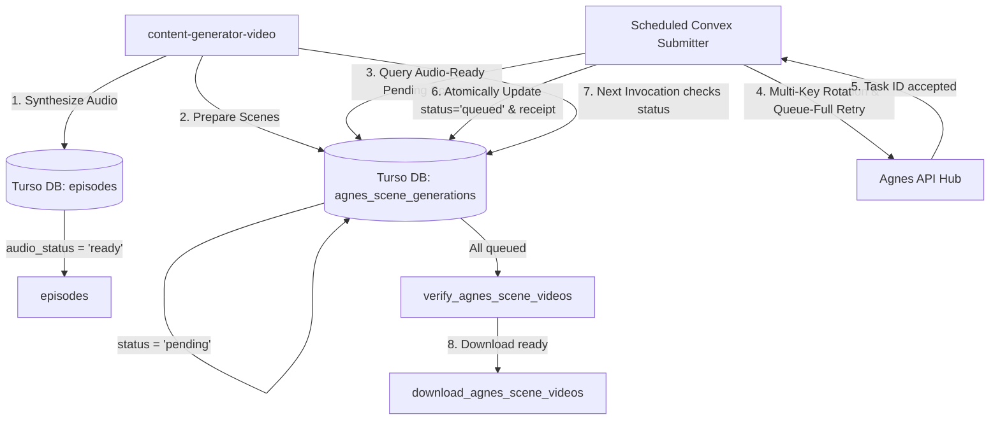

# Agnes Convex Submitter

Dedicated Convex scheduled backend service and resilient video submitter for Agnes 2.5 Flash generations.

## Overview

When generating 20–24 scenes per episode using the Agnes Free Tier, the Agnes submission queue frequently encounters capacity limits (`video_queue_full` / HTTP 503 / 429). The standard generator agent in `content-generator-video` operates in ephemeral runs and may pause or exit when the queue is full.

This project runs continuously via **Convex Scheduled Functions (Crons)** and an on-demand runner:
1. **Picks only pending scenes** whose episode audio has already been verified and generated (`audio_status = 'ready'`).
2. **Never touches already queued or completed scenes** (`status != 'pending'` or `provider_task_id IS NOT NULL`).
3. **Maximizes submission chances** using multi-key rotation and intelligent exponential backoff with jitter on `video_queue_full` and capacity errors (inspired by `C:\work\freeai-video-deepagent`).
4. **Maintains 100% receipt synchronization** with `content-generator-video` so that when `content-generator-video` runs again, it discovers all scenes are already queued/acknowledged, verifies their status, and downloads the finished videos.

---

## Architecture & Synchronization



### Database Synchronization Contract
- **Audio Readiness**: Verified against `episodes.audio_status = 'ready'` or `episodes.status IN ('audio', 'assembly')`.
- **Pending Filter**: `agnes_scene_generations.status = 'pending' AND agnes_scene_generations.provider_task_id IS NULL`.
- **Receipt Envelope**: Matches Schema Version 3 (`kind: "agnes-single-scene"`), recording:
  - `taskId` (e.g., `task_...`)
  - `keyFingerprint` (SHA-256 of the submitting API key)
  - `keyLabel` (e.g., `key-1`)
  - `accountId` (e.g., `account-1`)
  - `state: "accepted"`

---

## Configuration (`.env`)

```ini
# Convex
CONVEX_URL=https://beloved-seahorse-139.convex.cloud/
CONVEX_DEPLOY_KEY=dev:beloved-seahorse-139|...

# Turso DB
TURSO_DATABASE_URL=libsql://deepagent-db-ry0502.aws-ap-south-1.turso.io
TURSO_AUTH_TOKEN=...

# Agnes API Keys (Multi-lane account rotation)
AGNES_API_KEY_1=...
AGNES_API_KEY_2=...
AGNES_API_KEY_3=...
AGNES_API_KEY_4=...
AGNES_API_KEY_5=...
AGNES_API_KEY_6=...
AGNES_API_KEY_7=...

# Submission Strategy
AGNES_BASE_URL=https://apihub.agnes-ai.com
AGNES_VIDEO_MODEL=agnes-video-2.5-flash
AGNES_CAPACITY_MAX_RETRIES=20
AGNES_CAPACITY_RETRY_INTERVAL_MS=5000
AGNES_CAPACITY_RETRY_JITTER_MS=3000
AGNES_MAX_SUBMISSIONS_PER_RUN=10
SUBMISSION_CRON_INTERVAL_MINUTES=2
```

---

## Available Commands

```bash
# Install dependencies
npm install

# Build TypeScript
npm run build

# Run a single submission cycle locally (inspects DB, logs pending/submitted, updates Turso)
npm run submit:once

# Run Convex dev server
npm run dev

# Deploy Convex backend and crons to Convex Cloud
npm run deploy
```
